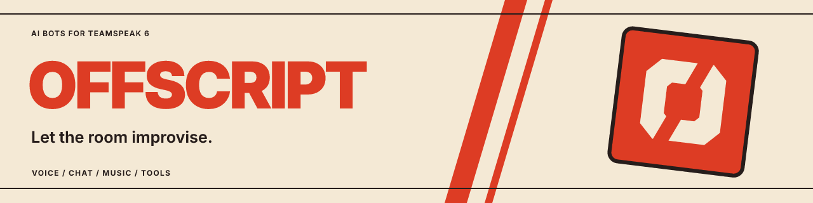

<p align="center"></p>

# TeamSpeak Universal Bot

A framework for running LLM-driven bots on **TeamSpeak 6**: they hear and
speak in voice channels, read and write text chat, remember what was said, play
music, and use tools — all driven by [OpenClaw](https://github.com/openclaw/openclaw)
agents. One container runs any number of bots; each bot is a **persona pack**:
a folder of markdown and JSON that defines who it is.

The bundled personas (see [`personas/`](personas/)) are examples. The
product is the framework, not any one character.

## What you get

- **Chat memory.** TeamSpeak does not persist channel text. Bots keep a
  markdown log of the room and catch up anyone who joins late.
- **Voice, both ways.** Speech-to-text in (local whisper.cpp by default,
  pluggable), text-to-speech out, with wake names, follow-up windows and a
  global voice kill switch. See [STT providers](docs/stt-providers.md).
- **Tools.** Music queue with ducking, `what_did_i_miss`, `who_is_here`, poke,
  moderation (kick/ban/move, gated by server group), web search, persona
  editing and more. See the [tool catalog](docs/tool-catalog.md).
- **Many bots, one container.** Each bot gets its own TeamSpeak identity,
  nick, avatar and OpenClaw agent, behind a single gateway.
- **Schedules and events.** Shifts, entrances and exits, two-bot scenes,
  guest appearances and special nights. See
  [schedules and events](docs/schedules-and-events.md).
- **Insights dashboard** with a Bots tab to enable, disable and edit bots.
  See [insights](docs/insights.md) and the [admin dashboard](docs/admin-dashboard.md).

## Quickstart

You need a TeamSpeak 6 server you can connect to, Docker, and a running
OpenClaw gateway container whose model credentials the first deploy imports
(`MAIN_GATEWAY`, default `OpenClaw`; without one the bots join but cannot answer).

```bash
image/build.sh                  # builds $IMAGE:<git sha> (IMAGE defaults to phattbeats/teamspeak-universal-bot)
TAG=<sha> image/deploy.sh       # (re)creates the teamspeak-universal-bot container;
                                # also reads NETWORK, APPDATA, MAIN_GATEWAY
```

Then edit `bots.json` in the container's `/config` volume (`$APPDATA/config`) (or use the dashboard's Bots tab) to choose
which personas run, and give each bot a TeamSpeak identity. Server-side you
need the bot's port reachable and, for moderation tools, a server group with
the matching permissions. The full walk-through, volumes and environment
variables are in [`image/README.md`](image/README.md).

Already run an OpenClaw gateway? Attach just the plugin and bridge: see
[Bring your own OpenClaw](docs/bring-your-own-openclaw.md).

## Architecture

```
TeamSpeak 6 server
      │  tsclientlib (one connection per bot)
      ▼
 core-<id>   Rust bot core (sexton/): identity, chat log, Opus, music/ducking mixer
      │  local WebSocket bridge (sexton/PROTOCOL.md)
      ▼
 OpenClaw gateway  ── teamspeak channel plugin (teamspeak-plugin/)
      │                 agents, tools, voice lanes, STT/TTS
      ├─ whisper pool        speech-to-text (whisper/)
      ├─ summoner            shifts, scenes, guests (ts-summoner/)
      └─ suno-api, POT       music generation / playback helpers
```

| directory | what |
| --- | --- |
| [`sexton/`](sexton/) | Rust core: one TeamSpeak client per bot (the crate and binary keep their historical name) |
| [`bridge-proto/`](bridge-proto/) | shared bridge protocol types |
| [`teamspeak-plugin/`](teamspeak-plugin/) | OpenClaw channel plugin: voice lanes, tools, chat commands |
| [`personas/`](personas/) | persona packs, shipped as examples |
| [`image/`](image/) | the all-in-one container: build, deploy, supervisor, gateway seed |
| [`ts-summoner/`](ts-summoner/) | schedules, scenes and guest appearances |
| [`whisper/`](whisper/) | local speech-to-text workers |
| [`docs/`](docs/) | guides and reference, start at the [index](docs/README.md) |

## Persona packs

A persona is a directory under `personas/<id>/` (or `config/personas/<id>/`
on a running box, no rebuild). The only required file is `voice.json`; the
rest shape the character. `personas/HUMAN.md` is a shared tone file loaded
under every pack. The shipped packs are examples to copy from:

| pack | role |
| --- | --- |
| `sexton` | the house host: dry, vulgar, runs the room |
| `bexton` | a band leader who composes and performs songs |
| `lexton` | a scheming villain who shows up on special nights |
| `johnny`, `trixie` | guest stars that drop in on band nights |

Write your own with [Writing a persona](docs/writing-personas.md).

## Documentation

Everything is indexed in [`docs/README.md`](docs/README.md). Contributing
rules are in [`CONTRIBUTING.md`](CONTRIBUTING.md).

## License

[PolyForm Noncommercial 1.0.0](LICENSE).
